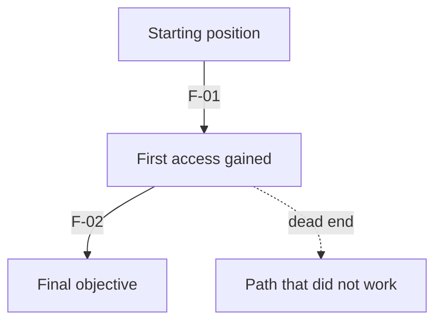

<!--
HOW TO USE THIS TEMPLATE
Copy this file to <category>/<engagement-name>/README.md and replace every placeholder in [brackets].
Delete these comments before publishing, and run the checklist in METHODOLOGY.md, section 4.
Keep the order of sections: readers learn where to look once and expect it in every report.
-->

# [Engagement type]: [Outcome in one line, with a number where there is one]

| | |
|---|---|
| **Format** | [e.g. Red team assessment, assumed breach, cyber range] |
| **Scope** | [Number of hosts, subnets, operating systems and key services] |
| **Starting position** | [What access was provided at the start, if any] |
| **Result** | [Objectives completed, hosts compromised, highest privilege reached] |
| **Duration** | [Total time, and time spent on dead ends] |
| **Assessed on** | [What the organisers scored: flags, methodology, operational security] |

> [!NOTE]
> [Environment statement: sanctioned lab or CTF, what has been sanitised.]

**Contents:** [Executive summary](#executive-summary) · [Scope and rules](#scope-and-rules) ·
[Approach](#approach) · [Attack path](#attack-path) · [Findings](#findings) ·
[Remediation priorities](#remediation-priorities) · [Dead ends](#dead-ends-and-time-lost) ·
[Retrospective](#retrospective) · [Skills demonstrated](#skills-demonstrated)

---

## Executive summary

<!--
One page at most, written for a decision-maker who reads nothing else.
Cover: what was achieved, how long it took, the 2-4 root causes, and the 3 fixes that matter most.
Avoid tool names and jargon here.
-->

[Outcome and time taken.]

[Root causes, as a short numbered list.]

[Priority fixes, with finding IDs.]

## Scope and rules

- **In scope:** [hosts, networks, services]
- **Out of scope:** [anything off-limits]
- **Starting position:** [assumed breach or no access; if access was provided, say no finding is raised for it]
- **Constraints:** [time limit, monitoring, rules on disruption]

### Environment

<!-- A simple network diagram: subnets, hosts, and which hosts could reach which. Sanitised names only. -->

```
[network diagram]
```

## Approach

<!--
The decisions that shaped the engagement, not a list of tools. 3-5 bullets.
Good: "Identified the highest-value account early and judged each move by whether it got closer."
Weak: "Ran a scanner, then ran another tool."
-->

- [Decision or habit, and where it paid off]

## Attack path

<!--
One diagram of how findings chained from the starting position to the final objective.
A Mermaid flowchart renders on GitHub. Label each edge with the finding ID that enabled it.
Mark dead ends with dotted lines.
-->



## Findings

| ID | Finding | Severity | Status | ATT&CK |
|---|---|---|---|---|
| F-01 | [Title] | [Critical/High/Medium/Low/Info] | [Confirmed/Potential] | [Txxxx.xxx] |

<!-- Order findings by severity, highest first. Use the scale in METHODOLOGY.md. -->

### F-01: [Title]

| | |
|---|---|
| **Severity** | [Rating]: [one line on why] |
| **Status** | [Confirmed, or Potential with the reason it was not exploited] |
| **ATT&CK** | [Technique ID and name] |
| **Affected** | [Hosts, accounts, services] |

**Weakness:** [What is wrong, stated as a configuration or design fact.]

**Impact:** [What it allowed, technically and in business terms.]

**Remediation:**
- *Stopgap:* [What to do now]
- *Root cause:* [What stops this class of problem coming back]

**Detection:** [The signal a defender could alert on, and where it is logged.]

### Strengths observed

<!-- Controls that worked or slowed you down. Reports that name strengths read as fair and credible. -->

- [Control that held, and what it prevented]

## Remediation priorities

<!-- Ordered by risk reduction, not discovery order. Include what must be rotated or rebuilt after a compromise. -->

1. [Fix] ([finding IDs])

## Dead ends and time lost

| Dead end | Time lost | Why it failed | What I learned |
|---|---|---|---|
| [Approach] | [~minutes] | [The underlying reason, not just "didn't work"] | [The lesson] |

[One line on total time lost against total time, and what that says.]

## Retrospective

<!-- What you would do differently. Be specific: process, preparation, operational security, time management. -->

1. [Change, and why]

## Skills demonstrated

<!-- Lead with methodology and reporting skills; keep technical areas general rather than listing tools. -->

- **Methodology:** [e.g. systematic access testing, time-boxing, root-cause analysis]
- **Technical areas:** [e.g. Active Directory, Windows and Linux privilege models, network segmentation]
- **Reporting:** [e.g. severity reasoning, remediation planning, detection notes]
