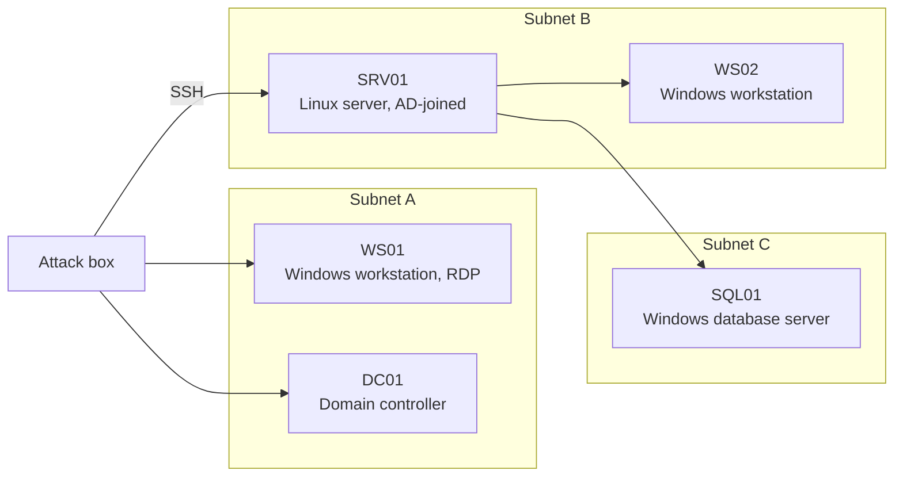
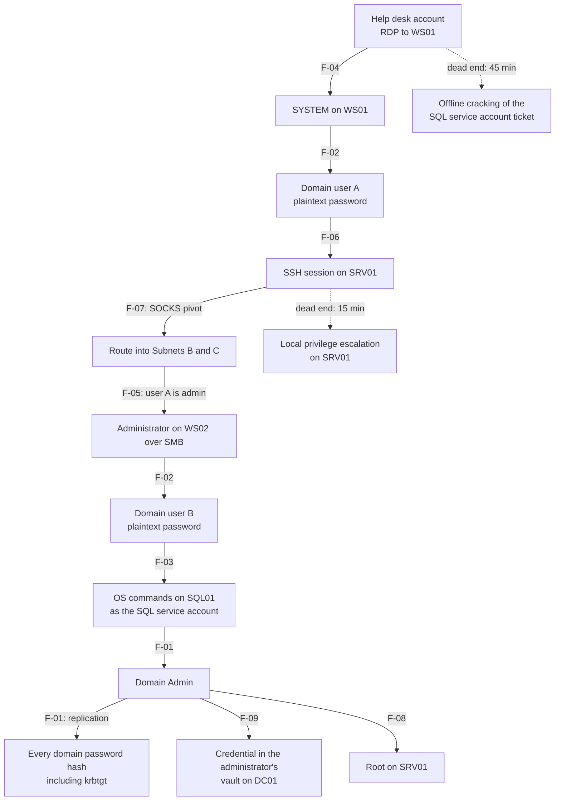

# Assumed-breach AD assessment: full domain compromise, 12/12 objectives in 3 h 37 m

| | |
|---|---|
| **Format** | Adversarial simulation in red team assessment format, assumed breach |
| **Scope** | 5 hosts across 3 subnets in one Active Directory domain: two Windows workstations, a Windows database server, an AD-joined Linux server and a domain controller |
| **Starting position** | A low-privilege help desk domain account with RDP access to one workstation |
| **Result** | 12/12 objectives, all 5 hosts compromised, Domain Admin at 2 h 37 m |
| **Duration** | 3 h 37 m, of which about 1 h 50 m went on dead ends |
| **Assessed on** | Objectives, methodology, tool choice and operational security. All activity was monitored, not just flag captures |

> [!NOTE]
> This was a sanctioned exercise, and the organisers allow public writeups with sanitised range details. Host names,
> the domain name, addresses, account names, flag values and credentials have been replaced or removed. Hosts are
> referred to by role: WS01, WS02, SQL01, SRV01 and DC01.

**Contents:** [Executive summary](#executive-summary) · [Scope and rules](#scope-and-rules) ·
[Approach](#approach) · [Attack path](#attack-path) · [Findings](#findings) ·
[Remediation priorities](#remediation-priorities) · [Dead ends](#dead-ends-and-time-lost) ·
[Retrospective](#retrospective) · [Skills demonstrated](#skills-demonstrated)

---

## Executive summary

Starting from a help desk account on a single workstation, I took full control of the domain in 2 hours 37 minutes
and completed every objective in 3 hours 37 minutes. All five systems were compromised. No software vulnerabilities
were exploited: every step used a stored password, or an account with more access than its job needed.

The four root causes:

1. **A database service account was a member of Domain Admins.** Anyone who gained control of the database server
   gained control of the whole domain, including every password in it.
2. **Passwords were stored in plain text for automatic logon** on two workstations. Each one gave up a domain account
   that unlocked the next system.
3. **Ordinary accounts held administrative rights they did not need.** These were a help desk account that could
   change a system service, a user who was a local administrator on a second workstation, and a user with full
   administrator rights on the database.
4. **Network separation was not backed by access control.** A Linux server connected to all three networks and
   accepted logins from any domain account, so the isolated networks were one login away.

The three fixes that matter most:

1. Remove the database service account from Domain Admins and replace it with a managed account limited to the
   database server ([F-01](#f-01-sql-service-account-is-a-domain-admin)).
2. Remove stored automatic logon passwords and give every workstation a unique local administrator password
   ([F-02](#f-02-plaintext-autologon-passwords-on-two-workstations),
   [F-05](#f-05-domain-user-is-local-administrator-on-a-second-workstation)).
3. Restrict who can log in to the server that bridges the networks, and filter traffic through it
   ([F-06](#f-06-bridge-server-accepts-ssh-from-any-domain-account),
   [F-07](#f-07-one-server-bridges-all-three-subnets)).

After a compromise this deep, every credential in the domain has to be treated as exposed. See
[Remediation priorities](#remediation-priorities).

## Scope and rules

- **In scope:** all five hosts and three subnets, and the Active Directory domain.
- **Out of scope:** anything outside the range.
- **Starting position:** assumed breach. A help desk domain account with RDP access to WS01 was provided, so no finding
  is raised for initial access.
- **Objectives:** two flags per host (one unprivileged, one privileged), a flag held in the database, and a protected
  credential stored on the domain controller. 12 in total.
- **Constraints:** a fixed time window, and all activity was monitored. Methodology and operational security were
  scored as well as objectives.
- **What the range simplified:** there was no EDR blocking tools, no SOC responding in real time and no active blue
  team, and the network was far smaller than a real estate. The attack chain itself was realistic; the opposition
  was not.

### Environment

The attack box could reach WS01, DC01 and SRV01 directly. SRV01 had routes into all three subnets. WS02 and SQL01
could only be reached through SRV01, and WS02 had no route back to the attack box at all. SRV01 was also reachable
from the Subnet A hosts, and its own agent called back to the attack box directly. WS02's agent traffic therefore ran
from the attack box to SRV01, and from SRV01 to WS02.

## Approach

- **Identified the highest-value account early.** Within the first hour, enumerating domain service accounts showed
  that the SQL service account was a Domain Admin. From then on I judged each move by whether it got me closer to that
  account.
- **Treated access as a graph.** I tested every credential I recovered against every host in scope, not just the host
  it came from. That is how the first recovered user turned out to have administrator access on WS02, a host in a
  different subnet.
- **Pivoted through the bridge, not around it.** SRV01 was the only host that could reach WS02 and SQL01. I logged in
  to it over SSH as the first recovered domain user, deployed an agent and ran a SOCKS proxy through it. SMB traffic
  to WS02 and the database client connection to SQL01 both went through that proxy. WS02 could not call back to the
  attack box, so I built a TCP relay on SRV01 to carry its agent's traffic.
- **Time-boxed, then asked why.** When four different methods of reading the DC's credential store all came back
  empty, I stopped trying tools and worked out why they were failing. All four used non-interactive sessions, and the
  credential was not loaded in those. That pointed me to reading it from disk instead.
- **Used the access I already held.** Linux root came from the domain, not from a local privilege escalation.
- **Operational security:** I changed the C2 framework's default listener settings before the engagement. The
  initial port scan ran from the attack box, which I would not do again (see [Retrospective](#retrospective)).

## Attack path

### Timeline

| Elapsed | Milestone |
|---|---|
| 0:00 | Start: help desk account on WS01 |
| 0:55 | SYSTEM on WS01 ([F-04](#f-04-help-desk-account-can-reconfigure-a-system-service)); domain user A recovered ([F-02](#f-02-plaintext-autologon-passwords-on-two-workstations)) |
| ~1:17 | SSH session on SRV01 as user A ([F-06](#f-06-bridge-server-accepts-ssh-from-any-domain-account)); SOCKS pivot established |
| ~1:57 | Administrator access to WS02 over SMB ([F-05](#f-05-domain-user-is-local-administrator-on-a-second-workstation)); domain user B recovered |
| ~2:37 | OS command execution on SQL01 as the SQL service account ([F-03](#f-03-regular-domain-user-is-sysadmin-on-the-database-server)); Domain Admin ([F-01](#f-01-sql-service-account-is-a-domain-admin)) |
| ~2:39 | Domain replication: every hash in the domain; access to DC01 |
| ~2:57 | Interactive SYSTEM agent on WS02 through the SRV01 relay |
| ~3:07 | Credential extracted from the administrator's vault on DC01 ([F-09](#f-09-sensitive-credential-stored-in-the-dcs-credential-manager)) |
| ~3:27 | Root on SRV01 ([F-08](#f-08-domain-admins-are-root-on-the-linux-server)) |
| 3:37 | All 12 objectives complete |

## Findings

| ID | Finding | Severity | Status | ATT&CK |
|---|---|---|---|---|
| F-01 | SQL service account is a Domain Admin | Critical | Confirmed | T1078.002, T1558.003, T1003.006 |
| F-02 | Plaintext AutoLogon passwords on two workstations | High | Confirmed | T1552.002, T1003.004 |
| F-03 | Regular domain user is sysadmin on the database server | High | Confirmed | T1505.001 |
| F-04 | Help desk account can reconfigure a SYSTEM service | High | Confirmed | T1543.003, T1529 |
| F-05 | Domain user is local administrator on a second workstation | High | Confirmed | T1078.002, T1021.002 |
| F-06 | Bridge server accepts SSH from any domain account | High | Confirmed | T1078.002, T1021.004 |
| F-07 | One server bridges all three subnets | Medium | Confirmed | T1090.001 |
| F-08 | Domain Admins are root on the Linux server | Medium | Confirmed | T1098, T1548.003 |
| F-09 | Sensitive credential stored in the DC's Credential Manager | Low | Confirmed | T1555.004 |

### F-01: SQL service account is a Domain Admin

| | |
|---|---|
| **Severity** | Critical: it turned any compromise of the database server into control of the whole domain |
| **Status** | Confirmed. The Kerberoasting route was attempted but not completed (see below) |
| **ATT&CK** | [T1078.002](https://attack.mitre.org/techniques/T1078/002/) Valid Accounts: Domain Accounts; [T1558.003](https://attack.mitre.org/techniques/T1558/003/) Kerberoasting; [T1003.006](https://attack.mitre.org/techniques/T1003/006/) DCSync; [T1550.002](https://attack.mitre.org/techniques/T1550/002/) Pass the Hash |
| **Affected** | SQL service account; SQL01; the whole domain |

**Weakness:** The account that runs the database service on SQL01 was a member of Domain Admins. It also had a service
principal name, so any domain user could request a Kerberos service ticket for it and try to crack the password
offline. I requested that ticket with the starting help desk account in the first hour. It was AES-256 encrypted,
and the password was not recovered within a 45-minute CPU-only time box.

**Impact:** Code running as the database service ran with Domain Admin rights. Once I had OS command execution on SQL01
([F-03](#f-03-regular-domain-user-is-sysadmin-on-the-database-server)), I used those rights to replicate every password
hash from Active Directory. Replication is a legitimate domain controller mechanism, and any Domain Admin can use it.
That gave me the domain administrator, the krbtgt account (whose key can forge Kerberos tickets for any user) and every
user and service account. The administrator's hash alone was enough to authenticate to DC01, with no plaintext
password needed. In business terms, one database server was the single point of failure for every system and identity
in the domain.

**Remediation:**
- *Stopgap:* Remove the SQL service account from Domain Admins and give it only the local rights the database service
  needs. Set a long random password.
- *Root cause:* Run services as [Group Managed Service Accounts](https://learn.microsoft.com/en-us/windows-server/identity/ad-ds/manage/group-managed-service-accounts/group-managed-service-accounts/group-managed-service-accounts-overview),
  which have long automatically rotated passwords and cannot practically be Kerberoasted. Review privileged group
  membership on a schedule, and treat any service account in a Tier 0 group as a critical exception that needs sign-off.

**Detection:**
- *Replication from a non-DC:* event 4662 on the domain object with the replication rights
  `1131f6aa-9c07-11d1-f79f-00c04fc2dcd2` (DS-Replication-Get-Changes) or `1131f6ad-9c07-11d1-f79f-00c04fc2dcd2`
  (DS-Replication-Get-Changes-All), requested by an account that is not a domain controller. Also watch for DRSUAPI
  replication traffic from an IP address that is not a DC. Microsoft Defender for Identity alerts on this pattern.
- *Kerberoasting:* the ticket was AES-256, so the common rule that alerts on RC4 ticket requests (event 4769 with
  encryption type `0x17`) would not have fired. Better signals are 4769 requests for a privileged account's service
  principal name from a host or user that does not normally use that service, or a decoy account with a service
  principal name that nothing legitimate should ever request.
- *Group membership:* events 4728, 4732 and 4756 for changes to privileged groups, together with regular reports on
  who is in them.

### F-02: Plaintext AutoLogon passwords on two workstations

| | |
|---|---|
| **Severity** | High: each stored password exposed a domain account that opened the next system |
| **Status** | Confirmed on WS01 and WS02 |
| **ATT&CK** | [T1552.002](https://attack.mitre.org/techniques/T1552/002/) Unsecured Credentials: Credentials in Registry; [T1003.004](https://attack.mitre.org/techniques/T1003/004/) OS Credential Dumping: LSA Secrets |
| **Affected** | WS01 (domain user A), WS02 (domain user B) |

**Weakness:** Both workstations were set to log a domain user in automatically at boot. This stores the user's password
in a form that any local administrator or SYSTEM process can read back in plain text.

**Impact:** On WS01, SYSTEM access ([F-04](#f-04-help-desk-account-can-reconfigure-a-system-service)) gave up user A's
password. User A could log in to SRV01 ([F-06](#f-06-bridge-server-accepts-ssh-from-any-domain-account)) and was an
administrator on WS02 ([F-05](#f-05-domain-user-is-local-administrator-on-a-second-workstation)). On WS02, I dumped
credentials remotely over SMB, which gave up user B's password, and user B was a sysadmin on the database
([F-03](#f-03-regular-domain-user-is-sysadmin-on-the-database-server)). Two convenience settings formed the middle of the
chain from help desk to Domain Admin.

**Remediation:**
- *Stopgap:* Disable AutoLogon on both workstations, clear the stored passwords and reset both accounts' passwords.
- *Root cause:* Do not use AutoLogon with domain accounts. Where a machine genuinely must log in unattended, such as a
  kiosk, use a dedicated local account that has no domain or network rights beyond its job. Check for the setting in
  configuration audits (`AutoAdminLogon` set to `1` under the Winlogon registry key).

**Detection:** On the host, SYSTEM-level reads of the `HKLM\SECURITY` hive by unexpected processes. For the remote dump
on WS02, the Remote Registry service starting (event 7036) and access to the `winreg` named pipe over SMB (event 5145).
Downstream of both, look for logons (event 4624) by the exposed accounts from hosts they have never used before.

### F-03: Regular domain user is sysadmin on the database server

| | |
|---|---|
| **Severity** | High: it let an ordinary user run operating system commands as a Domain Admin |
| **Status** | Confirmed |
| **ATT&CK** | [T1505.001](https://attack.mitre.org/techniques/T1505/001/) Server Software Component: SQL Stored Procedures |
| **Affected** | SQL01, domain user B |

**Weakness:** User B, an ordinary domain account, held the sysadmin role on the SQL01 database instance. Sysadmin can
switch on the database's built-in OS command execution feature, which is off by default, and run commands as the
database service account.

**Impact:** Over a database client connection through the SOCKS pivot, I enabled command execution and ran commands on
SQL01 as the SQL service account, which made me a Domain Admin ([F-01](#f-01-sql-service-account-is-a-domain-admin)). It
also exposed the database contents, including the database objective.

**Remediation:**
- *Stopgap:* Remove sysadmin from user B and from any other non-DBA account. Make sure OS command execution is disabled.
- *Root cause:* Grant database access through roles scoped to specific databases and actions. Keep sysadmin for a
  small, named DBA group, and review membership regularly.

**Detection:** SQL Server writes a message to its error log and the Windows Application log (event 15457) when the
`xp_cmdshell` option is changed. Alert on it. On the host, `sqlservr.exe` starting `cmd.exe` or `powershell.exe`
(event 4688 or Sysmon event 1) is a strong signal on its own.

### F-04: Help desk account can reconfigure a SYSTEM service

| | |
|---|---|
| **Severity** | High: it took a standard user to SYSTEM on WS01 |
| **Status** | Confirmed |
| **ATT&CK** | [T1543.003](https://attack.mitre.org/techniques/T1543/003/) Create or Modify System Process: Windows Service; [T1529](https://attack.mitre.org/techniques/T1529/) System Shutdown/Reboot |
| **Affected** | WS01, a telemetry service running as SYSTEM with automatic start, the help desk account |

**Weakness:** The service's access control list gave the help desk account permission to change its configuration,
including the program it runs. The same account also held the privilege to shut down the machine.

**Impact:** I changed the service's program path, rebooted, and Windows started my program as SYSTEM. That gave me full
control of WS01 55 minutes in, and with it the AutoLogon password ([F-02](#f-02-plaintext-autologon-passwords-on-two-workstations)).
I found it by enumerating service permissions, privileges and startup settings with tooling run in memory, not by
guessing.

**Remediation:**
- *Stopgap:* Remove the change-configuration permission from non-administrators on this service, and remove the
  shutdown privilege from standard accounts where it is not needed.
- *Root cause:* Audit service permissions across the estate as part of build and configuration review. Permissions
  like this usually build up through inherited group policy and one-off fixes, so they need checking on a schedule,
  not just at build time.

**Detection:** A change to a service's `ImagePath` registry value (Sysmon event 13 under
`HKLM\SYSTEM\CurrentControlSet\Services`). A shutdown started by a non-administrator (event 1074). A SYSTEM service
starting a program from a user-writable path.

### F-05: Domain user is local administrator on a second workstation

| | |
|---|---|
| **Severity** | High: it gave administrative access across a subnet boundary, to a host holding the next credential |
| **Status** | Confirmed |
| **ATT&CK** | [T1078.002](https://attack.mitre.org/techniques/T1078/002/) Valid Accounts: Domain Accounts; [T1021.002](https://attack.mitre.org/techniques/T1021/002/) SMB/Windows Admin Shares |
| **Affected** | WS02, domain user A |

**Weakness:** User A, whose password was exposed on WS01, was a local administrator on WS02 in a different subnet,
which their role did not require.

**Impact:** Once the SOCKS pivot was in place, user A's credentials gave me administrative SMB access to WS02. I used it
for a remote credential dump and remote execution. That exposed user B and, through F-03, the database server.

**Remediation:**
- *Stopgap:* Remove user A from WS02's local Administrators group, and review that group on every workstation.
- *Root cause:* Grant local administrator rights only through managed groups scoped to the machines a role supports.
  Deploy [Windows LAPS](https://learn.microsoft.com/en-us/windows-server/identity/laps/laps-overview) so every built-in
  local administrator password is unique and rotated.

**Detection:** A network logon (event 4624, logon type 3) followed by special privileges (event 4672) on WS02 for an
account that does not normally administer it. Access to the `ADMIN$` or `C$` shares (event 5140). A new service created
for remote execution (event 7045).

### F-06: Bridge server accepts SSH from any domain account

| | |
|---|---|
| **Severity** | High: any domain user could get a shell on the one host that reaches every subnet |
| **Status** | Confirmed |
| **ATT&CK** | [T1078.002](https://attack.mitre.org/techniques/T1078/002/) Valid Accounts: Domain Accounts; [T1021.004](https://attack.mitre.org/techniques/T1021/004/) Remote Services: SSH |
| **Affected** | SRV01 |

**Weakness:** SRV01's Active Directory integration accepted SSH logins from any domain account. No group or host
restriction was set.

**Impact:** User A, a workstation user, logged in to SRV01 directly from the attack box. That foothold carried the agent
and SOCKS proxy that reached WS02 and SQL01, long before I had Domain Admin. Without it, the isolated subnets would have
needed a different way in.

**Remediation:**
- *Stopgap:* Restrict SSH and SSSD logins on SRV01 to a named administration group (for example with SSSD's
  `simple_allow_groups`, or `AllowGroups` in the SSH server configuration).
- *Root cause:* Make "deny by default, allow named groups" the standard for every AD-joined Linux host. Bridge hosts
  should accept logins only from administrators of the systems they serve.

**Detection:** SSH authentication logs on SRV01 (`auth.log` or `secure`) showing logins by domain accounts that have
never logged in there before, especially accounts that belong to workstation users.

### F-07: One server bridges all three subnets

| | |
|---|---|
| **Severity** | Medium: it widened every other weakness to the isolated subnets, but needed a login (F-06) to use |
| **Status** | Confirmed |
| **ATT&CK** | [T1090.001](https://attack.mitre.org/techniques/T1090/001/) Proxy: Internal Proxy |
| **Affected** | SRV01; Subnets B and C |

**Weakness:** SRV01 had routes into all three subnets, and nothing filtered traffic passing through it. WS02 and SQL01
were isolated from the attack box, but not from SRV01.

**Impact:** One SSH session on SRV01 made WS02 and SQL01 reachable. I ran SMB and a database client through a SOCKS
proxy on it, and a TCP relay so WS02's agent could reach me. The segmentation was real, but one host undid it.

**Remediation:**
- *Stopgap:* Restrict SRV01 to the connections its role needs, with host firewall rules on SRV01 and network rules
  between subnets. Block SMB and database ports from SRV01 unless they are required.
- *Root cause:* Treat any host connected to more than one security zone as part of every zone it touches. Design
  segmentation so crossing a boundary needs both a network path and an authenticated, authorised identity.

**Detection:** Flow logs showing SRV01 opening SMB (445) or database (1433) connections into Subnets B and C. New
listening ports on SRV01. Long-lived outbound sessions from SRV01 to hosts outside the estate.

### F-08: Domain Admins are root on the Linux server

| | |
|---|---|
| **Severity** | Medium: it extended domain compromise to root on Linux, but needed Domain Admin first |
| **Status** | Confirmed |
| **ATT&CK** | [T1098](https://attack.mitre.org/techniques/T1098/) Account Manipulation; [T1548.003](https://attack.mitre.org/techniques/T1548/003/) Abuse Elevation Control Mechanism: Sudo and Sudo Caching |
| **Affected** | SRV01 |

**Weakness:** The Domain Admins group was mapped into SRV01's sudoers, so every Domain Admin had full root.

**Impact:** SRV01 was well hardened locally (see [Strengths observed](#strengths-observed)). Instead of escalating
locally, I reset the SQL service account's domain password from DC01, logged in to SRV01 over SSH as that account,
and ran sudo. That gave me root. Every AD-joined Linux host configured this way falls with the domain.

**Remediation:**
- *Stopgap:* Remove Domain Admins from sudoers on SRV01 and replace it with a dedicated Linux administration group.
- *Root cause:* Give Linux administration its own AD group with small, audited membership. Treat AD-joined Linux hosts
  as within the Tier 0 blast radius when planning identity controls.

**Detection:** On DC01, a password reset on a service account (event 4724) followed soon after by an interactive or
SSH login by that account. A service account logging in interactively is unusual on its own. On SRV01, sudo logs
showing root sessions for service accounts.

### F-09: Sensitive credential stored in the DC's Credential Manager

| | |
|---|---|
| **Severity** | Low: it was only reachable after domain compromise, but it extends that compromise to whatever the credential protects |
| **Status** | Confirmed |
| **ATT&CK** | [T1555.004](https://attack.mitre.org/techniques/T1555/004/) Credentials from Password Stores: Windows Credential Manager |
| **Affected** | DC01, the domain administrator's credential vault |

**Weakness:** A credential was saved in the administrator's Credential Manager vault on DC01. In this exercise it was
planted as an objective. It stands in for any sensitive credential an administrator might save there, such as a
service password, access to an external system or a backup key. Credential Manager protects entries with DPAPI, and on
a domain-joined machine DPAPI's keys can be recovered through the domain's DPAPI backup key.

**Impact:** Once I had Domain Admin, I extracted the vault files from disk and had DC01 decrypt the master key over the
network using the domain backup key. In plain terms, the domain controller removed its own credential protection
because a Domain Admin asked. DPAPI protects against casual local access. It is not a boundary against someone who
controls the domain, and any secret it protects falls with the domain.

**Remediation:**
- *Stopgap:* Remove saved credentials from administrators' vaults on domain controllers and other Tier 0 hosts, and
  rotate whatever they protected.
- *Root cause:* Store sensitive credentials in a secrets manager whose trust does not depend on Active Directory, and
  do not use domain controllers for anything but domain services.

**Detection:** File share access (event 5145) to the `Microsoft\Credentials` or `Microsoft\Protect` folders under a
user profile on a domain controller. Remote calls to the DC's DPAPI backup key service, which arrive over named-pipe
RPC on the `protected_storage` pipe. DPAPI master key recovery events (event 4693) outside normal password-reset
activity.

### Strengths observed

- **SRV01 was well hardened locally.** It had a recent, patched kernel, no exploitable SUID binaries, scheduled jobs
  or misconfigured services. A 15-minute local escalation attempt found nothing, and root came only from the domain.
- **The isolated subnets had no direct route from the attack box.** WS02 could not call back to the attack box at
  all, which forced a relay through SRV01 and made the pivot slower and more visible.
- **The privileged service account's ticket used AES-256.** Its password was not recovered by offline cracking in the
  time available.
- **Credential Manager entries were not exposed to non-interactive sessions.** Four live extraction methods failed
  before the disk-based route worked.

## Remediation priorities

1. **Remove the SQL service account from Domain Admins** and move services to Group Managed Service Accounts
   ([F-01](#f-01-sql-service-account-is-a-domain-admin)).
2. **Recover from the domain compromise.** Reset the krbtgt account twice, allowing replication between resets. Reset
   every user, administrator and service account password. Rotate every secret that was protected by DPAPI on
   domain-joined machines, or saved on DC01. Check every host for persistence before trusting it again
   ([F-01](#f-01-sql-service-account-is-a-domain-admin), [F-09](#f-09-sensitive-credential-stored-in-the-dcs-credential-manager)).
3. **Remove AutoLogon passwords and deploy Windows LAPS**, and remove unneeded local administrator rights
   ([F-02](#f-02-plaintext-autologon-passwords-on-two-workstations),
   [F-05](#f-05-domain-user-is-local-administrator-on-a-second-workstation)).
4. **Restrict logins and traffic on SRV01** ([F-06](#f-06-bridge-server-accepts-ssh-from-any-domain-account),
   [F-07](#f-07-one-server-bridges-all-three-subnets)).
5. **Remove sysadmin from non-DBA accounts** and keep database OS command execution disabled
   ([F-03](#f-03-regular-domain-user-is-sysadmin-on-the-database-server)).
6. **Fix service permissions** and remove the shutdown privilege from standard users
   ([F-04](#f-04-help-desk-account-can-reconfigure-a-system-service)).
7. **Replace the Domain Admins sudoers mapping** with a dedicated Linux administration group
   ([F-08](#f-08-domain-admins-are-root-on-the-linux-server)).
8. **Move saved credentials off domain controllers** into a secrets manager
   ([F-09](#f-09-sensitive-credential-stored-in-the-dcs-credential-manager)).
9. **Enable detection for replication from non-DC sources**, the highest-value alert in this chain.

### Changes made to the environment

No clean-up was recorded at the end of the exercise. In a real engagement, each of these would be listed for the
client and reverted, or handed over for them to remove.

| Change | Host | Risk if left in place | Action |
|---|---|---|---|
| Telemetry service program path changed | WS01 | Attacker code runs as SYSTEM at every boot | Restore the original path and check the binary |
| Scheduled task created for persistence | WS01 | Attacker code keeps running | Remove the task |
| Rebooted twice | WS01 | None ongoing | Record only |
| Database OS command execution enabled | SQL01 | OS commands from any sysadmin login | Disable it |
| SQL service account password reset | Domain | The database service fails at next restart; a known password is in use | Set a new random password and update the service, or move to a gMSA |
| C2 agents deployed | All 5 hosts | Remote control of every host | Remove them, and confirm none remain |
| TCP relay started | SRV01 | An open path into Subnet B | Stop and remove it |

## Dead ends and time lost

| Dead end | Time lost | Why it failed | What I learned |
|---|---|---|---|
| Kerberoasting the SQL service account | ~45 min | The ticket was AES-256, which is far slower to crack offline than RC4, and I had no GPU. The same account was reachable through the credential chain without cracking anything | Check the ticket's encryption type before committing to cracking, and time-box offline attacks. The indirect route was faster than the direct one |
| First SYSTEM payload on WS01 | ~15 min | It was not a real service binary. It did not answer the Service Control Manager, so Windows killed it after about 30 seconds, along with my agent. Re-establishing access took a second reboot | Understand how the host OS manages your process, not just whether it executes |
| Live extraction from Credential Manager on DC01 | ~20 min | Four methods, same empty result. Every session I had was non-interactive, and the vault is only loaded for interactive logons | When several tools fail the same way, look for the shared cause rather than a fifth tool |
| Decrypting the vault from disk | ~15 min | Two of three approaches failed on tool-specific format issues | Keep more than one route to the same result. The working one was the simplest: ask the DC to decrypt it |
| Local privilege escalation on SRV01 | ~15 min | The host was patched and correctly configured | Sometimes the answer isn't on the box. Check what your existing access already allows |

About 1 h 50 m of 3 h 37 m went on paths that did not work. Dead ends are normal in an assessment. The skill is spotting
them quickly and changing approach, and most of these ended with a reason rather than an abandoned attempt.

## Retrospective

1. **Deploy backup agents before risky operations.** I ran a single agent on three hosts while doing things that could
   kill it. When one died, I had to rebuild access the slow way. Against active defenders, that rebuild window is when
   you get caught.
2. **Know the C2 framework's native pivoting before the engagement.** My SOCKS proxy and TCP relay on SRV01 worked, but
   they were manual and fragile. The framework's built-in relay would have been more reliable and quieter. I chose the
   custom route because I was more familiar with it at the time.
3. **Scan from compromised hosts, not the attack box.** My initial port scan ran from the attack box, which shows
   network monitoring where the attacker is. Scanning from an internal host blends in with normal traffic.
4. **Time-box offline attacks, and check whether they are feasible first.** An AES-256 ticket and no GPU meant the
   cracking attempt was unlikely to succeed. I could have seen that at the start instead of after 45 minutes.
5. **Avoid disruptive changes to production identities.** Resetting the SQL service account's password got me root on
   SRV01, but in a real environment it would break the database service at its next restart. I should have looked for
   a route that did not change a live credential, and in a real engagement a change like that needs approval first.
6. **Record clean-up in the operation log as I go.** I made seven kinds of change to the environment and recorded none
   of them as reverted. Logging each change with its revert step at the time is what makes clean-up possible.

**Assessor feedback.** The assessors credited changing the C2 listener defaults, the relay design and the clarity of
the investigation report. They flagged the single-agent setup during risky operations, and the full rebuild after one
agent died, as the main operational security weaknesses. They did not share whether specific actions were detected.

## Skills demonstrated

- **Methodology:** treating access as a graph and testing every credential against every host, finding the
  highest-value target early, time-boxing, and working out why approaches fail before trying the next tool.
- **Technical areas:** Active Directory and Kerberos, Windows service and privilege models, credential storage and
  DPAPI, database server security, Linux and AD integration, and pivoting through segmented networks.
- **Reporting:** consolidating attack steps into root-cause findings, reasoned severity, ATT&CK mapping, remediation
  ordered by risk reduction, detection notes for each finding, and honest reporting of dead ends and environment changes.
